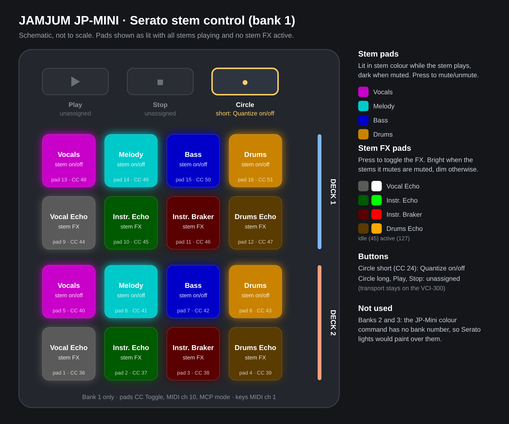

# Jamjum JP-MINI - Serato stem control

A ready-to-load setup that turns a **JAMJUM JP-MINI** pad controller into a **Serato DJ Pro stems and stem FX controller** for two decks, with pads that light up to show what each stem is doing.

It was built to sit next to a Vestax VCI-300, which already handles transport, cues, loops, EQ, FX and browsing, so the JP-MINI does stems and nothing else. Tested with Serato DJ Pro 5.0.0.950 on Windows 11 and JP-MINI firmware V4 (KuSuite 5.2).

Inspired by [SDR3078/mvave-smc-pad-ableton](https://github.com/SDR3078/mvave-smc-pad-ableton): measure what the controller really sends first, then map it.

## What's in this repo

| File | What it is |
| --- | --- |
| [`config/JAMJUM-MCU-FX.jpmini`](config/JAMJUM-MCU-FX.jpmini) | Controller preset for JAMJUM's KuSuite editor. Pads in CC Toggle mode with MCP mode on. |
| [`config/JP-MIDI-MCP-v3.2.xml`](config/JP-MIDI-MCP-v3.2.xml) | Serato DJ Pro MIDI mapping, including the SysEx that lights the pads. |
| [`docs/serato-xml-notes.md`](docs/serato-xml-notes.md) | What we learnt about writing Serato mapping XML by hand. |
| [`docs/jp-mini-findings.md`](docs/jp-mini-findings.md) | Hardware and protocol findings for this controller. |
| [`docs/jp-mini-layout.svg`](docs/jp-mini-layout.svg) | The layout image above, as SVG. |

## Install

### 1. Load the controller preset (KuSuite)

1. Connect the JP-MINI by USB and open JAMJUM's **KuSuite** editor.
2. Open/import `config/JAMJUM-MCU-FX.jpmini`.
3. Check bank 1: the 16 pads should show as **MCP-** CC Toggle on channel 10 (KuSuite shows this as **9**, because it counts channels from 0), CC 36 to 51, values 0 and 127.
4. Write the preset to the JP-MINI.
5. Put the controller on **bank 1**. Banks 2 and 3 are not used by the Serato mapping.

### 2. Install the Serato mapping

1. Close Serato DJ Pro.
2. Copy `config/JP-MIDI-MCP-v3.2.xml` into Serato's MIDI preset folder:
   - Windows: `C:\Users\<your user>\Music\_Serato_\MIDI\xml`
   - macOS: `~/Music/_Serato_/MIDI/xml` (untested)
3. **Power-cycle the JP-MINI** (unplug it, plug it back in).
4. Start Serato DJ Pro and open **Setup → MIDI**.
5. Enable the JP-MINI in the device list and turn on its output (lighting).
6. Select the JP-MINI, pick **JP-MIDI-MCP-v3.2** from the preset list and click **Load**. Load it once only (see the note on stacked mappings below).
7. Load a track that has stems on decks 1 and 2 and press a stem pad. The pad should go dark when the stem mutes and light again when it comes back.

If the lights or pads act strangely after loading, **quit Serato, power-cycle the JP-MINI and start again** before changing anything. Most odd behaviour during development went away after a clean restart of both.

## ⚠️ Don't save over this mapping in Serato

**Any edit and save in Serato's MIDI panel rewrites the XML file and strips out all the SysEx lighting.** The pads keep working, but they stop lighting.

If you want to add or change something:

- Save your Serato changes **under a new preset name**, then copy the new `<control>` blocks into a copy of `JP-MIDI-MCP-v3.2.xml` by hand, or
- Edit the XML directly in a text editor (see [docs/serato-xml-notes.md](docs/serato-xml-notes.md)).

Keep an untouched copy of `JP-MIDI-MCP-v3.2.xml` somewhere outside Serato's folder.

## Pad and button map

Pads are numbered 1 to 16 from the **bottom-left**, in rows of four going up. Bank 1 only. Pads send CC on MIDI channel 10; keys send CC on channel 1.

| Pad | CC | Deck | Serato function | Light |
| --- | --- | --- | --- | --- |
| 13 | 48 | 1 | Vocals stem on/off | magenta when playing, off when muted |
| 14 | 49 | 1 | Melody stem on/off | cyan / off |
| 15 | 50 | 1 | Bass stem on/off | blue / off |
| 16 | 51 | 1 | Drums stem on/off | amber / off |
| 9 | 44 | 1 | Vocal Echo (stem FX) | white: bright when vocals are muted, dim otherwise |
| 10 | 45 | 1 | Instrumental Echo | green: bright when melody, bass and drums are all muted |
| 11 | 46 | 1 | Instrumental Braker | red: bright when melody, bass and drums are all muted |
| 12 | 47 | 1 | Drums Echo | amber: bright when drums are muted |
| 5 | 40 | 2 | Vocals stem on/off | magenta / off |
| 6 | 41 | 2 | Melody stem on/off | cyan / off |
| 7 | 42 | 2 | Bass stem on/off | blue / off |
| 8 | 43 | 2 | Drums stem on/off | amber / off |
| 1 | 36 | 2 | Vocal Echo | white bright/dim |
| 2 | 37 | 2 | Instrumental Echo | green bright/dim |
| 3 | 38 | 2 | Instrumental Braker | red bright/dim |
| 4 | 39 | 2 | Drums Echo | amber bright/dim |

| Key | Short press | Long press |
| --- | --- | --- |
| Play | CC 22, unassigned | CC 27, unassigned |
| Stop | CC 23, unassigned | CC 28, unassigned |
| Circle | CC 24: **Quantize on/off** | CC 29, unassigned |

## Why it's set up this way

- **Bank 1 only.** The JP-MINI's light command has no bank number and the bank switch sends no MIDI, so Serato can't tell which bank is showing. Lights meant for bank 1 would paint over banks 2 and 3. Hot cues and sampler banks were built and then shelved for this reason.
- **MCP mode on the pads.** In normal mode the JP-MINI sends every pad press on two USB MIDI ports about 9 ms apart. Serato listens to both, so each press arrived twice and stems flipped off and straight back (or never came back on). MCP mode sends on the third port only, so each press arrives once. No bridge software or Windows port tricks are needed.
- **Channel numbering.** KuSuite counts MIDI channels from 0. Its "9" is MIDI channel 10, which is what the Serato XML calls `channel="10"`.
- **Stem pads use CC Toggle + `explicit`.** The pad itself alternates 127 and 0, and Serato sets the stem on or off from that value. The pad keeps its own on/off memory, so if you change a stem on screen or load a new track, the next press may look like it does nothing and a second press catches up.
- **FX pads use Serato's own learned block.** `Relative OnOff` with a press/toggle, copied unchanged from a mapping Serato wrote itself.
- **FX lights follow the stems they mute.** Serato rejected every attempt to light a pad from the FX state directly. Serato's stem FX work by muting stems (Vocal Echo mutes vocals; Instrumental Echo and Braker mute melody, bass and drums; Drums Echo mutes drums), so the FX pads go bright when those stems are muted. Muting a stem by hand will also brighten the matching FX pad.
- **Brighter FX lights.** Active FX are full brightness (127) and idle FX glow at 45, so they hold their own next to the stem colours.
- **Circle = quantize.** Quantize is a single global setting and the key only sends a press (never a release), so it's mapped as one `Relative OnOff` toggle per press. Serato also sends the quantize state back to CC 24; if your Circle light stays on whatever quantize is doing, delete the `<userio event="output">` block under `control="24"` in the XML.
- **Play and Stop are deliberately unassigned.** Transport lives on the VCI-300, and the stem actions tried on these keys weren't reliable enough to keep.

## Findings about this JP-MINI

Short version below; details in [docs/jp-mini-findings.md](docs/jp-mini-findings.md).

- Shows up as three MIDI port pairs (`JP-Mini`, `MIDIIN2 (JP-Mini)`, `MIDIIN3 (JP-Mini)`). In normal mode each pad press goes out on the first two, about 9 ms apart. MCP mode (bit 7 of the pad's first config byte, the **MCP / MCU** tick box in KuSuite) moves it to the third port only.
- Pads are numbered bottom-left upwards in rows of four. In this setup deck 1 is pads 9 to 16 and deck 2 is pads 1 to 8.
- The Play / Stop / Circle keys send different CCs for a short press (22 / 23 / 24) and a long press (27 / 28 / 29), value 127, and **never send a release**.
- Switching banks sends no MIDI at all.
- The pad LEDs are true RGB and can be set from the computer with a SysEx command, but that command has no bank number: it always writes to the bank that's showing.

## What we learnt about Serato mapping XML

Full notes in [docs/serato-xml-notes.md](docs/serato-xml-notes.md). The headlines:

- Conditions (`cmp_value`) must use the function's **alias names** (`on`, `off`). Numbers like `1` / `0` get the whole file rejected.
- Stems are `codfather_st` (slot 0 Vocals, 1 Melody, 2 Bass, 3 Drums). Stem FX are `codfather_fx` (slot 0 Vocal Echo, 1 Instrumental Echo, 2 Instrumental **Braker** (Serato's own spelling), 3 Drums Echo).
- For global toggles (quantize), use `data_type="Relative OnOff"` with `action_on="press" behaviour="toggle"`.
- MIDI-learning a global control in Serato can create one toggle per deck. Four toggles on one press cancel out, so a press sometimes seems to do nothing. Keep one.
- Saving in Serato strips `<sysex>` blocks.
- Serato's error message is just "MIDI XML is not valid", with no line number. Add one block at a time.
- Restart Serato and power-cycle the controller before debugging odd lights.

## Credits

- Approach inspired by [SDR3078/mvave-smc-pad-ableton](https://github.com/SDR3078/mvave-smc-pad-ableton).
- Stem function slot tables cross-checked against the community [Kovarsk/SERATO-XML-WIKI](https://github.com/Kovarsk/SERATO-XML-WIKI).
- Not affiliated with JAMJUM, KUWEE or Serato. Use at your own risk.

## License

[MIT](LICENSE)
